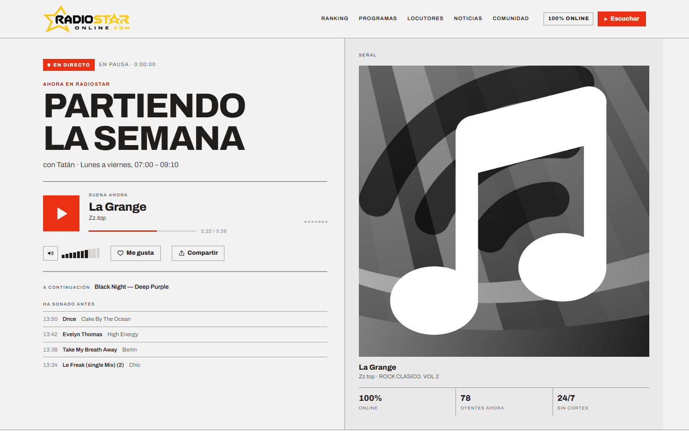

# RadioStar

Sitio web de RadioStar, una radio online de Santiago. Lo desarrollé como
freelance para la emisora y hoy está en producción en
[radiostaronline.com](https://www.radiostaronline.com).



## Qué hace el sitio

La página principal permite escuchar la radio en directo y muestra qué canción
está sonando, cuáles sonaron antes y cuántos oyentes hay conectados. Más abajo
hay un video con un ranking de nueve canciones y, cuando termina, una encuesta para
votar la mejor canción. El resto del sitio presenta los programas, a los
locutores y una sección de noticias musicales que se actualiza sola.

## Cómo está construido

El sitio es HTML, CSS y JavaScript sin framework. Lo decidí así porque es
una página de contenido con un reproductor: no tiene pantallas que cambien de
estado ni formularios complejos, y un framework habría agregado peso sin
resolver ningún problema que tuviera. Como no hay paso de build, cualquiera
puede abrir los archivos y entender qué se está sirviendo.

Lo que no se puede hacer desde el navegador vive en tres funciones serverless
en Vercel, dentro de `api/`. Ninguna usa paquetes de npm; Node ya trae `fetch`,
y con eso alcanza.

La emisora transmite con AzuraCast, un servidor de radio que expone el stream
de audio y una API con lo que está sonando. El navegador consulta esa API cada
15 segundos para actualizar el reproductor.

## Problemas que tuve que resolver

### Los nombres de las canciones venían sucios

Las canciones de la emisora salen de un pool de remezclas para DJ, y sus
etiquetas traen de todo: el BPM al principio, el nombre del DJ que hizo la
versión entre corchetes y, muchas veces, el artista y el título intercambiados.
Una etiqueta típica es `"130 dime . beth [ diego marti reload ]"`. Mostrar eso
en el reproductor se veía mal.

Una parte de la solución es limpiar el texto en el servidor. `api/top40.js` lee el
historial de emisión, quita lo que sobra, corrige las inversiones que se pueden
detectar y devuelve un diccionario que traduce cada etiqueta cruda a un título
y un artista legibles. El navegador usa ese diccionario antes de mostrar la
canción.

Eso resolvió la mayoría de los casos, pero no todos. Si una etiqueta dice
`"128 blue"` como artista y `"eiffel 65"` como título, no hay nada en el texto
que indique que están al revés. Para esos casos escribí
`scripts/corrige-nombres.js`, que busca cada etiqueta en el catálogo de iTunes
probando las dos combinaciones posibles y se queda con la que más se parece
al resultado. Para medir el parecido uso el coeficiente de Dice sobre bigramas
de letras, que tolera bien las diferencias de puntuación y espacios.

Lo más importante del script es lo que hace cuando no está seguro: no aplica
la corrección y la deja en un archivo para revisarla a mano. Una búsqueda
aproximada sobre texto sucio puede devolver la canción equivocada, y atribuirle
una canción al artista que no corresponde me pareció peor que dejar el nombre
feo. Lo probé con 12 etiquetas reales de la emisora: corrigió 9, no atribuyó
ninguna mal y dejó intactas 3 que no tenían arreglo (un megamix, un archivo
con el nombre roto y una canción que no está en iTunes).

El archivo se llama `top40.js` porque al principio el sitio mostraba un Top 40
calculado con el historial de emisión de los últimos 7 días. Esa tabla se
reemplazó por el ranking en video, pero el cálculo sigue en el código y se
puede volver a mostrar.

### La encuesta necesitaba guardar votos sin un servidor propio

Los votos de la encuesta tienen que ser los mismos para todos los visitantes,
así que necesitaba guardarlos en algún lado. Para no mantener un servidor usé
Redis a través de su API REST (Upstash), que tiene un plan gratuito de 10.000
operaciones al día.

Para no pasarme de ese límite, la respuesta con el recuento se guarda 15
segundos en la caché de Vercel. Así, aunque entren cientos de personas, Redis
recibe solo unas pocas consultas por minuto. Los votos en sí nunca pasan por
la caché.

La función acepta únicamente las nueve canciones del video. Cualquiera puede
enviar una petición con lo que quiera, así que el servidor descarta todo lo
que no esté en esa lista.

Mientras la emisora no conecte Redis, la encuesta muestra un recuento de
demostración marcado como tal. Los números salen de la hora actual y no del
azar, para que todos vean lo mismo y nunca bajen al recargar la página. Cuando
se configure Redis, la demostración se desactiva sola.

### El directo se quedaba en silencio sin avisar

En el celular, cuando la pantalla se bloquea o la conexión cambia de wifi a
datos, el stream se corta, pero el elemento `<audio>` no lanza ningún error:
simplemente deja de avanzar. El usuario ve el botón de pausa y no escucha
nada.

La función `vigilaEmision()` en `assets/js/app.js` revisa cada segundo si el
audio sigue avanzando y, si lleva 12 segundos detenido, reconecta. Al
desbloquear el teléfono hace la revisión de inmediato. No uso el evento
`stalled` del navegador porque también se dispara en pausas normales de carga
y cortaría el audio sin motivo.

### El ranking en video competía con la radio

El video del ranking tiene su propio audio. Si la radio seguía sonando, se
escuchaban las dos cosas al mismo tiempo. Ahora la radio se pausa cuando el
video empieza y se reanuda sola cuando termina.

Después de votar, la sección se reduce para mostrar solo el podio y la canción
que eligió esa persona, aunque no haya quedado entre las tres primeras. Si
alguien la cierra, el sitio recuerda qué versión del ranking cerró, y cuando
la emisora sube un video nuevo, la sección vuelve a aparecer.

### Las noticias no se podían leer desde el navegador

Las noticias vienen del RSS de 20minutos, que no permite que otros sitios lo
lean desde el navegador (no envía cabeceras CORS). `api/noticias.js` lo lee
desde el servidor, lo convierte a JSON y lo deja 15 minutos en la caché de
Vercel, así que la fuente recibe pocas visitas sin importar cuánta gente entre.

## Otras decisiones

El contenido fijo (programas, locutores) está escrito en el HTML y no se
genera con JavaScript, para que los buscadores lo puedan leer. Solo se genera
desde JavaScript lo que cambia durante el día.

Los nombres de las canciones vienen de una fuente externa, así que se insertan
en la página como texto plano (`textContent`) y nunca como HTML. De lo
contrario, una etiqueta mal formada podría inyectar código en el sitio.

Si falta alguna clave de configuración, cada función responde con un aviso
claro en vez de fallar, y la página sigue funcionando con lo que tiene.

## Correrlo en local

```sh
npx serve .     # solo la parte estática
vercel dev      # el sitio y las funciones de api/ (requiere la CLI de Vercel)
```

Las variables de entorno están descritas en [`.env.example`](.env.example).
El sitio se puede ver sin configurar ninguna.

## Estructura

```
index.html                  La página completa
assets/css/styles.css       Estilos
assets/js/app.js            Reproductor, "suena ahora", ranking y encuesta
assets/js/noticias.js       Sección de noticias
api/top40.js                Limpieza de nombres de canciones (y el Top 40)
api/encuesta.js             Votos de la encuesta, guardados en Redis
api/noticias.js             Lectura del RSS de noticias
scripts/corrige-nombres.js  Corrección de nombres con el catálogo de iTunes
docs/                       Manual de operación para la emisora y pendientes
```

Escribí también un [manual de operación](docs/OPERACION.md) para la emisora,
con los pasos para conectar el stream, Redis y AzuraCast, y para regenerar las
imágenes del sitio sin tener que llamarme.
